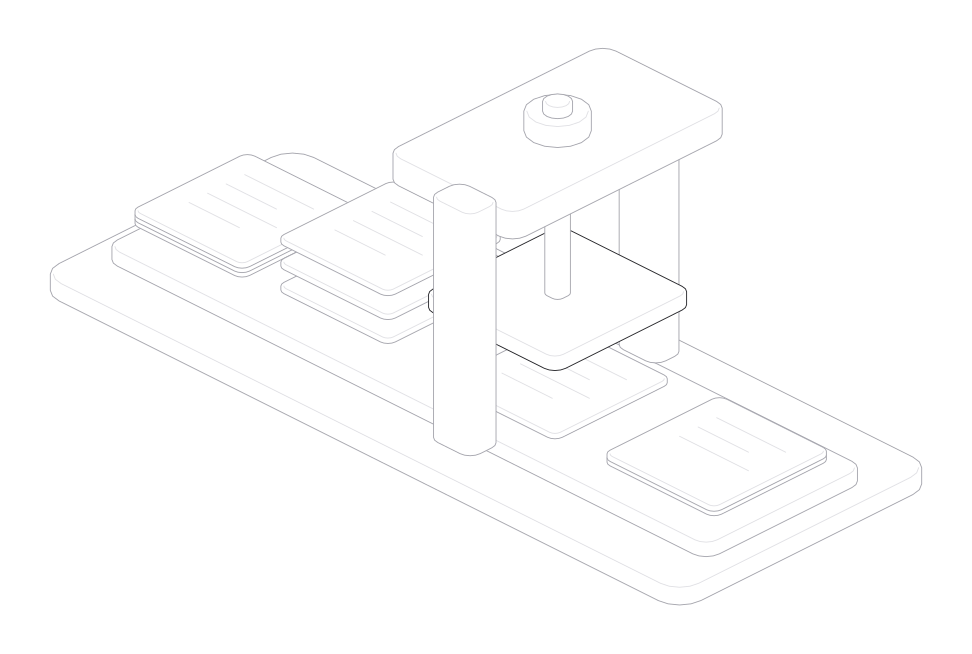

# mermlint

Check Mermaid diagrams before they reach your docs.

A small CLI for Markdown, Obsidian vaults, standalone diagrams, and stdin.
Errors point back to the original line, with repair hints for you or your agent.

**Node.js 22.12+ · Mermaid 12.1 · Zero runtime dependencies**

[Install](#install) · [Agent skill](#agent-skill) · [How it works](#how-it-works) · [CLI reference](docs/cli.md)

## Install

Clone the repository and install the prebuilt command with Bun:

```sh
git clone https://github.com/aaditagrawal/mermlint.git
cd mermlint
bun install --global --production .
```

Then check a file or a folder:

```sh
mermlint docs/
```

No build step. To run straight from the checkout without Bun or installation:

```sh
node ./dist/mermlint.js docs/
```

The package name is `mermlinter`; the command is `mermlint`.
Registry installation will be available after the package is published to npm.

## Agent skill

The CLI includes a [12-line skill](agent-skills/mermaid-linter/SKILL.md).
Install it for your agent:

```sh
mermlint install-skill --codex
# Or:
mermlint install-skill --claude
```

It teaches the agent to check the changed file, read the repair hints, fix syntax
without changing meaning, and rerun. It also checks that diagrams were found.

Use `--project` for `./.claude/skills`, `--dir PATH` for another skills directory,
or `--force` to update a copy. Without a global install, replace `mermlint` with
`node ./dist/mermlint.js`.

## How it works

<picture>
  <source media="(prefers-color-scheme: dark)" srcset="docs/assets/how-it-works-dark.svg">
  
</picture>

Source sheets, separated snippets, a syntax check, and an output report.
[Download the interactive figure](docs/hairline-inspection-press.html) and open it
in a browser. Hover over a stage or press **play** to follow the inspection.

1. **Read.** Discover files, skip dependencies and vault metadata, and deduplicate paths.
2. **Extract.** Find Mermaid fences and retain their original line and column positions.
3. **Validate.** Load the needed Mermaid grammars and check syntax, with workers for large batches.
4. **Report.** Return source locations, code frames, and repair hints in discovery order.

Unchanged files reuse their reports. Edited files reuse unchanged diagrams and
rebuild their source locations. Prose-only edits can skip the parser entirely.

## Use it

```sh
mermlint architecture.md                     # Terminal output
mermlint notes/ --format json                # One structured report
mermlint notes/ --format ndjson              # One result per line
mermlint notes/ --no-cache                   # Recheck every diagram
printf 'flowchart TD\nA --> B\n' | mermlint --stdin --format json
```

Supported inputs include `.md`, `.markdown`, `.mmd`, and `.mermaid`.
Backtick and tilde fences work, including Mermaid inside Obsidian callouts.
All 37 built-in Mermaid 12.1 diagram registrations have regression fixtures.

Exit `0` means all discovered diagrams passed, `1` means validation failed,
and `2` means an invocation or runtime failure. Check `summary.snippets` in
JSON reports: zero means no diagrams were found.

Parsing checks syntax and upstream diagram rules. Check rendering and older
editor engines in their host apps. External diagram plugins are not bundled.

## Further reading

- [CLI reference](docs/cli.md): flags, diagnostics, supported diagrams, and caching.
- [Performance notes](bench/NOTES.md): profiles, before/after measurements, and reproduction commands.
- [Contributing](CONTRIBUTING.md): build, tests, and parser adapters.
- [Changelog](CHANGELOG.md) · [MIT license](LICENSE).
