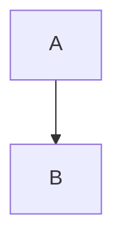

# Mermaid linter

Run the narrowest relevant file after creating or editing a diagram. Prefer an
installed `mermlint`, or `node ./dist/mermlint.js` when working in this repository.
The package runner is `bunx mermlinter`, once the package is published. The CLI
requires Node 22.12+ and validates Mermaid 12.1 syntax.

```sh
mermlint docs/architecture.md --format json
mermlint notes/ --format ndjson
printf '%s\n' 'flowchart TD' 'A --> B' | mermlint --stdin --name generated.mmd --format json
```

Use the process exit status and report together:

- `0`: discovered diagrams passed. Check `summary.snippets` before claiming that a diagram was checked. A zero count means none were found.
- `1`: syntax or diagram validation failed. Use each failed result's `source` and `error.line` / `error.column` to locate the edit in the original file.
- `2`: invocation or runtime failure. Resolve the CLI problem before changing diagram syntax.

Read `error.frame` and `error.agent.repairHints`. Make the smallest change that
preserves the diagram's meaning, then rerun the same file. Source coordinates are
one-based. `relativeLine` / `relativeColumn` refer to the extracted snippet;
`parserLine` / `parserColumn` preserve raw parser coordinates, which can differ
after comments or frontmatter are removed. EOF diagnostics point to the last
real diagram line.

For example, repair a missing flowchart target by adding the intended node:



For raw generated text use stdin; for Markdown use the whole file so diagnostics
map to the file. Markdown supports backtick and tilde fences, including Obsidian
callout blockquotes. Vault scans skip `.obsidian`, `.git`, `node_modules`, and
symlinks. NDJSON ends with a `{ "summary": ... }` record.

The content cache invalidates when file contents change. Use `--no-cache` when
investigating unexpected results. Parsing does not verify rendering, layout,
links, or compatibility with an older Mermaid version embedded in a host app.
External diagram plugins such as ZenUML are not bundled. If the host app uses an
older engine or a plugin, also validate in that host before claiming compatibility.
